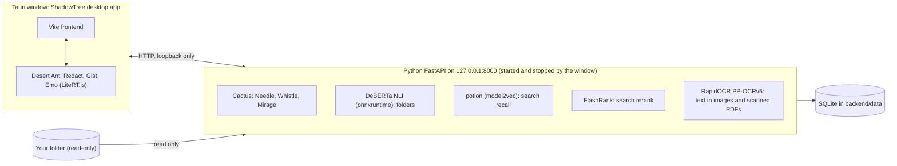

# ShadowTree

**A virtual file system for the mess in your folders. Your real files are never touched.**

ShadowTree reads a messy folder, uses AI that runs on your own PC to describe and sort each file, and shows the files in clean virtual folders. Nothing is moved, renamed, written or deleted on disk.

## The problem

Downloads folders fill up with files named `scan0042.pdf` and `Screenshot 2026-11-20.png`. Tidying them by hand takes hours. Cloud tools sort them well, but they upload your invoices, notes and IDs.

## Who it's for

Anyone with a messy folder and private files: students, freelancers, small offices.

## What makes it different

- **Non-destructive.** Files are opened read-only. The index lives in `backend\data\`, never in your folder.
- **Fully on-device.** Models run on your PC. File contents, text and summaries never leave it. See [Network & privacy](#network--privacy).
- **Privacy built in.** Files with personal data (emails, phone numbers, names) go to a "Sensitive (PII)" folder, and the Redacted view hides the values.
- **Works when AI fails.** Each file has an `ai_status` (`ok`, `fallback`, `error`). A failed model still gives a title, summary and keywords.

## How it works



There is no PyTorch and no GLiClass. The same app also runs in a normal browser (`npm run dev`) with the same backend.

## Run it (Windows, PowerShell)

Needs Python 3.12 (on your PATH as python, not the Microsoft Store shortcut), Node.js 24, Rust 1.96 with the Visual Studio C++ build tools, and WebView2 (Tauri builds and shows the window with them). The backend models for sorting, search and OCR are about 153 MB, plus about 76 MB for the Cactus models and browser models are 114 MB. Run from a fresh clone, in the repo root.

```powershell
# 1. Backend setup (once)
python -m venv backend\.venv
backend\.venv\Scripts\python.exe -m pip install -r backend\requirements.txt
backend\.venv\Scripts\python.exe -m pip install -r backend\requirements-dev.txt
backend\.venv\Scripts\python.exe scripts\download_models.py      # about 230 MB in all, once

# 2. Frontend setup (once)
cd frontend
npm install
npm run fetch-models                                              # about 114 MB, once
cd ..

# 3. A fake sample folder to try (creates a ShadowTree Demo folder in your Documents, with sample_messy_folder inside)
backend\.venv\Scripts\python.exe scripts\make_samples.py "$env:USERPROFILE\Documents\ShadowTree Demo"
```

**Main way: the desktop app.** The window starts the backend for you and stops it when you close the window.

```powershell
cd frontend
npm run tauri dev
```

Choose the `sample_messy_folder` folder (with the button, or drag it onto the window) and press "Index (Read-Only)".

**Other way: in the browser.** Start the backend in one PowerShell window. Stop it later with Ctrl+C. Stop 
pm run dev with Ctrl+C too.

```powershell
cd backend
.\.venv\Scripts\python.exe -m uvicorn app.main:app --host 127.0.0.1 --port 8000 --workers 1
```

Open a second PowerShell window, in the repo root:

```powershell
cd frontend
npm run dev
```

Open the address Vite prints (`http://localhost:5173`). Type the full path of the `sample_messy_folder` folder and press "Index (Read-Only)".

Optional: build the app file (no installer). It takes about 5 minutes the first time and makes `frontend\src-tauri\target\release\shadowtree.exe` (about 138 MB, with the browser models inside).

```powershell
cd frontend
npm run fetch-models
npm run tauri build
```

Tests and build, from the repo root:

```powershell
cd backend
.\.venv\Scripts\python.exe -m pytest -q
cd ..\frontend
npm run build
```

**First run.** Models download once, which takes a few minutes. After that the backend runs offline. With all models loaded, the backend uses about 625 MB of RAM (working set, measured in the desktop window after a scan, searches and a new folder, OCR included; peak 627 MB). The old GLiClass model alone used 2.3 GB. The first scan of the 8 sample files takes about 10 seconds on this PC (CPU only). Some files may show a basic summary: when the title and summary model returns nothing, the file is still indexed with a title from its name. The first `npm run tauri dev` compiles the Rust shell and takes 2 to 3 minutes. If port 8000 already runs ShadowTree, the window uses it and leaves it running when you close. The backend log is `backend\data\tauri-backend.log`. If you move the app, set `$env:SHADOWTREE_REPO` to the repo folder.

A 2-3 minute demo walk-through is in [docs/demo_script.md](docs/demo_script.md).

## Models

| Model | Lab | License | Size | Job |
|---|---|---|---|---|
| [deberta-v3-xsmall-zeroshot-v1.1-all-33](https://huggingface.co/MoritzLaurer/deberta-v3-xsmall-zeroshot-v1.1-all-33) (ONNX, quantized) | Moritz Laurer | MIT | 95.9 MB | Sorts files into folders: does this text match this folder? |
| [potion-base-8M](https://huggingface.co/minishlab/potion-base-8M) (`model2vec`) | Minish Lab | MIT | 30.9 MB | Search recall (a 256-number vector per file), and a quick filter for new folders |
| [ms-marco-TinyBERT-L-2-v2](https://huggingface.co/cross-encoder/ms-marco-TinyBERT-L-2-v2) (ONNX, `flashrank`) | Microsoft cross-encoder, packaged by FlashRank | Apache-2.0 for the original. The FlashRank copy, [prithivida/flashrank](https://huggingface.co/prithivida/flashrank), is tagged CC-BY-SA-4.0 | 5.0 MB | Re-orders search results |
| PP-OCRv5 mobile (`rapidocr`) | PaddleOCR (Baidu), converted by RapidOCR | Apache-2.0 | 21.5 MB (detector and multilingual recognizer) | Reads text in images and scanned PDFs |
| Needle, Whistle, Mirage ([Cactus](https://github.com/cactus-compute/cactus)) | Cactus Compute | Apache-2.0 | 35.3 MB, 16.9 MB, 21.6 MB | Titles and summaries, speech to text, image description |
| Redact, Gist, Emo | Desert Ant Labs | Desert Ant license (see Network & privacy) | about 114 MB together | Hides personal data, finds topics, picks emoji, in the browser |

Licenses were read from each model card or package page on 2026-11-25.

## How search ranks

Search finds candidates with SQLite full-text search and potion vectors, then FlashRank re-orders them. The match percentage comes from this formula (`backend/app/search.py`). `z` is the FlashRank score as a logit, `cos` is the potion cosine, and `bm25_norm` is the full-text score from 0 to 1.

```
Weights of the parts that exist are renormalised
(each mix is divided by the sum of the weights it uses):

confident (best z >= -6, i.e. the reranker found a real match):
    mix = 0.6 * sigmoid((z + 4) / 2) + 0.3 * min(cos / 0.6, 1) + 0.1 * bm25_norm
otherwise (reranker sees only noise, z about -11 for every file):
    semantic-only mix = min(cos / 0.35, 1)
    with full-text hits, bm25_norm joins at weight 0.3 against 0.7 for the cosine part
match = round(100 * mix) + name boost (+20 when every query word is in the name or title)
```

Results below a match of 25 are listed as "weak".
## Built for this hackathon

Everything in this repo was written for this hackathon: the FastAPI backend, scanner, search, the web UI, the Tauri desktop shell and the privacy pass. The AI models and runtimes in the credits below are third-party and used as published.

## Known limitations

- **Needle is extractive.** The Cactus Needle model copies words from the file. Its titles and summaries can look rough.
- **Search ranks by meaning, with small local models.** The order is approximate. "money I spent" lists the bank transfer note first, then the voice memo, and the receipt and invoice after them. Plain words such as "invoice", "pay the bill" or "my diary" land well. A search takes about 4 ms (8 files) to 31 ms (164 files) once warm.
- **Windows only.** Paths, the Reveal button and the voice memo sample use Windows features.
- **Old indexes.** An index made before the model change keeps its old folder scores. Delete `backend\data\veilfs.db` and scan again for a clean start.
- **Desert Ant license check.** The Desert Ant browser models contact `events.desertant.com` when they load. It has no opt-out. No file content is sent. Details in Network & privacy.
- **The folder sorter is strict.** DeBERTa only files a document under a folder when it is fairly sure. On a large real folder, many files stay in Unsorted: in one test, 124 of 164 PDFs. On the sample folder all files are sorted, but the Work & Research margin is thin (scores 0.575 and 0.591 against a 0.5 cut-off), so a small change to a file could move it to Unsorted.
- **Privacy check first.** A file whose privacy check has not finished (or could not run) shows only its name and "Privacy check not available", never its text.
- **Desktop drag and drop.** The native folder dialog and the drop handler are wired, but a real drag from Explorer was not tested by hand.
- **OCR is good, not perfect.** On the sample screenshot it read the error code right, but on a test scanned bill it dropped one space ("30November"). Only the first 3 pages of a scanned PDF are read. The first scan after an upgrade reads old images and thin PDFs again, which runs Mirage and Needle on them once.

## Next steps (not built)

These are planned and are **not** in this version:

- **Audio:** Silero VAD + Moonshine, for voice detection and speech to text.
- **Desert Ant v6 upgrade + Eye**, the newer Desert Ant release and its image model.

## Network & privacy

File contents, text, summaries and results never leave your machine. These are the only outbound requests ShadowTree makes:

| # | Request | When | Hosts | What |
|---|---|---|---|---|
| 1 | Backend model downloads | Once, by `scripts/download_models.py` (run it with `backend\.venv\Scripts\python.exe scripts\download_models.py`) | `huggingface.co`, `us.aws.cdn.hf.co`, `cas-bridge.xethub.hf.co`, `modelscope.cn` (OCR models) | Cactus repos `Cactus-Compute/cactus` (engine `libcactus.dll`, 1.9 MB), `needle3` (35.3 MB), `whistle` (16.9 MB), `mirage` (21.6 MB). `MoritzLaurer/deberta-v3-xsmall-zeroshot-v1.1-all-33` (`model_quantized.onnx` and tokenizer), `minishlab/potion-base-8M`, the FlashRank ms-marco-TinyBERT-L-2-v2 model, and the PP-OCRv5 mobile models for RapidOCR (from `modelscope.cn`, with a SHA256 check). After that the backend runs with `HF_HUB_OFFLINE=1` and Cactus telemetry off (`CACTUS_TELEMETRY=0`, `DO_NOT_TRACK=1`). |
| 2 | Browser model downloads | Once, by `npm run fetch-models`; and when the app loads a model whose local files are missing | `huggingface.co`, `us.aws.cdn.hf.co` | `desert-ant-labs/redact` v0.4.2, `desert-ant-labs/gist` v2.2.0, `desert-ant-labs/emo` v0.7.0. `cd frontend; npm run fetch-models` downloads them once (about 114 MB) into `frontend\public\models\`. With these files in place, nothing is fetched from Hugging Face while the app runs. The app contacts Hugging Face only as a fallback, when the local model files are missing. |
| 3 | Desert Ant license check | Browser and desktop window, when the app loads a Desert Ant model | `events.desertant.com` | `POST https://events.desertant.com/api/v1/license` and `/api/v1/activate`. Sends a random install ID, the site domain, the model and its version, the SDK name and version, and the platform (and an API key if one is set; ShadowTree sets none). It never sends inputs, outputs or file content. It has no opt-out, and ShadowTree does not block, spoof or redirect it (license section 6). If it fails, the model still runs. It was not seen in the last two test runs; it is not blocked. |

The desktop app's content security policy allows 'unsafe-eval' for scripts, because the Desert Ant wasm glue builds code from a string. Scripts still load only from the app itself (no inline scripts, no remote script hosts). The Tauri window loads only the local app and talks only to `http://127.0.0.1:8000`. `pip install` and `npm install` also contact `pypi.org` and the npm registry once. The Windows WebView2 runtime that draws the window also contacts Microsoft hosts on its own (port 443). That is Windows, not ShadowTree code, and none of it carries your files. Nothing else: no cloud AI APIs, no analytics.

**License version.** The npm packages `@desert-ant-labs/*@5.0.0` ship `LICENSE.md` v1.0 (a pointer to [license.desertant.com/1.0](https://license.desertant.com/1.0)), and the site is at v1.1 (30 October 2026). ShadowTree relies on [v1.1](https://license.desertant.com/1.1.txt) because it describes the license check the 5.0.0 SDK makes, while [v1.0](https://license.desertant.com/1.0.txt) only describes usage "telemetry" that counts monthly active devices.

**Credit.** A "Powered by Desert Ant Labs" credit linking to [desertant.com](https://desertant.com) is in the app sidebar footer now.

## Credits & third-party

| Component | Used for | License |
|---|---|---|
| [Cactus Compute](https://github.com/cactus-compute/cactus) (`cactus-compute`, Needle, Whistle, Mirage) | On-device titles, summaries, speech and image text | Apache-2.0 |
| [Moritz Laurer](https://huggingface.co/MoritzLaurer) (`deberta-v3-xsmall-zeroshot-v1.1-all-33`) | Sorting files into folders | MIT |
| [Minish Lab](https://github.com/MinishLab/model2vec) (`model2vec`, `potion-base-8M`) | Search recall and the new-folder filter | MIT |
| [FlashRank](https://github.com/PrithivirajDamodaran/FlashRank) (`flashrank`) and [ms-marco-TinyBERT-L-2-v2](https://huggingface.co/cross-encoder/ms-marco-TinyBERT-L-2-v2) | Re-ordering search results | Package Apache-2.0. Original model Apache-2.0. FlashRank's model copy CC-BY-SA-4.0 |
| [RapidOCR](https://github.com/RapidAI/RapidOCR) (`rapidocr`) and [PaddleOCR](https://github.com/PaddlePaddle/PaddleOCR) (PP-OCRv5 mobile) | Reading text in images and scanned PDFs | Apache-2.0 |
| [ONNX Runtime](https://onnxruntime.ai) (`onnxruntime`) | Runs the DeBERTa and OCR models | MIT |
| [Hugging Face tokenizers](https://github.com/huggingface/tokenizers) | Tokenizing text for DeBERTa | Apache-2.0 |
| [pypdfium2](https://github.com/pypdfium2-team/pypdfium2) | Drawing scanned PDF pages in memory for OCR | BSD-3-Clause or Apache-2.0 |
| [Tauri](https://tauri.app) | The desktop window | Apache-2.0 or MIT |
| [Desert Ant Labs](https://desertant.com) (`@desert-ant-labs/redact`, `gist`, `emo`) | Redacting personal data, topics, emoji, in the window | Desert Ant license (see Network & privacy) |
| [LiteRT.js](https://github.com/google-ai-edge/LiteRT) (`@litertjs/core`) | Runs the Desert Ant models in the window | Apache-2.0 |
| [FastAPI](https://fastapi.tiangolo.com) | Backend API | MIT |
| [Uvicorn](https://www.uvicorn.org) | Backend server | BSD-3-Clause |
| [pypdf](https://github.com/py-pdf/pypdf) | Reading PDF text | BSD-3-Clause |
| [Pillow](https://python-pillow.org) | Reading images, drawing the sample screenshot | MIT-CMU |
| [fpdf2](https://github.com/py-pdf/fpdf2) | Makes the sample PDF (`scripts\make_samples.py` only) | LGPL-3.0 |
| [Vite](https://vite.dev) | Frontend dev server and build | MIT |

**Powered by [Desert Ant Labs](https://desertant.com).** The ShadowTree code is MIT licensed, see [LICENSE](LICENSE). Other packages in `backend\requirements.txt` and `frontend\package-lock.json` keep their own licenses.
