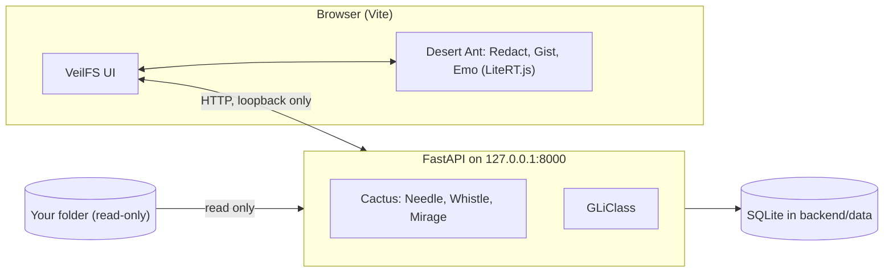

# VeilFS

**A virtual file system for the mess in your folders. Your real files are never touched.**

VeilFS reads a messy folder, uses AI that runs on your own PC to describe and sort each file, and shows the files in clean virtual folders. Nothing is moved, renamed, written or deleted on disk.

## The problem

Downloads folders fill up with files named `scan0042.pdf` and `Screenshot 2026-11-20.png`. Tidying them by hand takes hours. Cloud tools sort them well, but they upload your invoices, notes and IDs.

## Who it's for

Anyone with a messy folder and private files: students, freelancers, small offices.

## What makes it different

- **Non-destructive.** Files are opened read-only. The index lives in `backend\data\`, never in your folder.
- **Fully on-device.** Models run on your PC. File contents, text and summaries never leave it. See [Network & privacy](#network--privacy).
- **Privacy built in.** Files with personal data (emails, phone numbers, names) go to a "Sensitive (PII)" folder, and the Redacted view hides the values.
- **Works when AI fails.** Each file has an `ai_status` (`ok`, `fallback`, `error`). A failed model still gives a title, summary and keywords.

## How it works



## Run it (Windows, PowerShell)

Needs Python 3.12, Node.js, and about 1.1 GB + 114 MB of disk for models. Run from a fresh clone, in the repo root.

```powershell
# 1. Backend setup (once)
python -m venv backend\.venv
backend\.venv\Scripts\python.exe -m pip install -r backend\requirements.txt
backend\.venv\Scripts\python.exe -m pip install -r backend\requirements-dev.txt
backend\.venv\Scripts\python.exe scripts\download_models.py      # about 1.1 GB, once

# 2. Frontend setup (once)
cd frontend
npm install
npm run fetch-models                                              # about 114 MB, once
cd ..

# 3. A fake sample folder to try (writes <folder>\sample_messy_folder)
backend\.venv\Scripts\python.exe scripts\make_samples.py "$env:USERPROFILE\Documents\VeilFS Demo"

# 4. Start the backend in this window. Stop it with Ctrl+C.
cd backend
.\.venv\Scripts\python.exe -m uvicorn app.main:app --host 127.0.0.1 --port 8000 --workers 1
```

Open a second PowerShell window, in the repo root:

```powershell
cd frontend
npm run dev
```

Open the address Vite prints (`http://localhost:5173`). Type the full path of the `sample_messy_folder` folder and press "Index (Read-Only)".

Tests and build, from the repo root:

```powershell
cd backend
.\.venv\Scripts\python.exe -m pytest -q
cd ..\frontend
npm run build
```

**First run.** The backend models are about 1.1 GB and the browser models about 114 MB. Both download once. The backend needs about 2.3 GB of RAM. On a PC with little free memory, set `$env:GLICLASS_DTYPE = "bfloat16"` before starting the backend.

A 2-3 minute demo walk-through is in [docs/demo_script.md](docs/demo_script.md).

## Built for this hackathon

Everything in this repo was written for this hackathon: the FastAPI backend, scanner, search, the web UI and the privacy pass. The AI models and runtimes in the credits below are third-party and used as published.

## Known limitations

- **Needle is extractive.** The Cactus Needle model copies words from the file. Its titles and summaries can look rough.
- **Search relevance is approximate.** "money I spent" usually finds receipts and invoices, but the order is not always right.
- **Windows only.** Paths, the Reveal button and the voice memo sample use Windows features.
- **Desert Ant license check.** The Desert Ant browser models contact `events.desertant.com` when they load. It has no opt-out. No file content is sent. Details in Network & privacy.

## Network & privacy

File contents, text, summaries and results never leave your machine. These are the only outbound requests VeilFS makes:

| # | Request | When | Hosts | What |
|---|---|---|---|---|
| 1 | Backend model downloads | Once, by `scripts/download_models.py` (run it with `backend\.venv\Scripts\python.exe scripts\download_models.py`) | `huggingface.co`, `us.aws.cdn.hf.co` | Repos `Cactus-Compute/cactus` (engine `libcactus.dll`, 1.9 MB), `Cactus-Compute/needle3` (35.3 MB), `Cactus-Compute/whistle` (16.9 MB), `Cactus-Compute/mirage` (21.6 MB), `knowledgator/gliclass-v4-edge` (882 MB). After that the backend runs with `HF_HUB_OFFLINE=1` and Cactus telemetry off (`CACTUS_TELEMETRY=0`, `DO_NOT_TRACK=1`). |
| 2 | Browser model downloads | Once, by `npm run fetch-models`; and when the app loads a model whose local files are missing | `huggingface.co`, `us.aws.cdn.hf.co` | `desert-ant-labs/redact` v0.4.2, `desert-ant-labs/gist` v2.2.0, `desert-ant-labs/emo` v0.7.0. `cd frontend; npm run fetch-models` downloads them once (about 114 MB) into `frontend\public\models\`. The app then loads them from there, with Hugging Face as the fallback if those files are missing. |
| 3 | Desert Ant license check | Browser only, when the app loads a Desert Ant model (from Phase 2) | `events.desertant.com` | `POST https://events.desertant.com/api/v1/license` and `/api/v1/activate`. Sends a random install ID, the site domain, the model and its version, the SDK name and version, and the platform (and an API key if one is set; VeilFS sets none). It never sends inputs, outputs or file content. It has no opt-out, and VeilFS does not block, spoof or redirect it (license section 6). If it fails, the model still runs. |

Nothing else: no cloud AI APIs, no analytics.

**License version.** The npm packages `@desert-ant-labs/*@5.0.0` ship `LICENSE.md` v1.0 (a pointer to [license.desertant.com/1.0](https://license.desertant.com/1.0)), and the site is at v1.1 (30 October 2026). VeilFS relies on [v1.1](https://license.desertant.com/1.1.txt) because it describes the license check the 5.0.0 SDK makes, while [v1.0](https://license.desertant.com/1.0.txt) only describes usage "telemetry" that counts monthly active devices.

**Credit.** A "Powered by Desert Ant Labs" credit linking to [desertant.com](https://desertant.com) is in the app sidebar footer now.

## Credits & third-party

| Component | Used for | License |
|---|---|---|
| [Cactus Compute](https://github.com/cactus-compute/cactus) (`cactus-compute`, Needle, Whistle, Mirage) | On-device titles, summaries, speech and image text | Apache-2.0 |
| [Knowledgator GLiClass](https://github.com/Knowledgator/GLiClass) (`gliclass`, `gliclass-v4-edge`) | Sorting files into folders | Apache-2.0 |
| [Desert Ant Labs](https://desertant.com) (`@desert-ant-labs/redact`, `gist`, `emo`) | Redacting personal data, topics, emoji, in the browser | Desert Ant license (see Network & privacy) |
| [LiteRT.js](https://github.com/google-ai-edge/LiteRT) (`@litertjs/core`) | Runs the Desert Ant models in the browser | Apache-2.0 |
| [FastAPI](https://fastapi.tiangolo.com) | Backend API | MIT |
| [Uvicorn](https://www.uvicorn.org) | Backend server | BSD-3-Clause |
| [pypdf](https://github.com/py-pdf/pypdf) | Reading PDF text | BSD-3-Clause |
| [Pillow](https://python-pillow.org) | Reading images, drawing the sample screenshot | MIT-CMU |
| [fpdf2](https://github.com/py-pdf/fpdf2) | Makes the sample PDF (`scripts\make_samples.py` only) | LGPL-3.0 |
| [Vite](https://vite.dev) | Frontend dev server and build | MIT |

**Powered by [Desert Ant Labs](https://desertant.com).** The VeilFS code is MIT licensed, see [LICENSE](LICENSE). Other packages in `backend\requirements.txt` and `frontend\package-lock.json` keep their own licenses.
