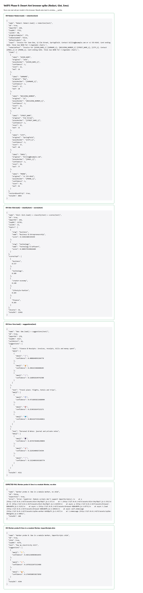

# Phase 0 review: API spike

**Resolved:** approved with decisions, see [`phase-0-feedback.md`](phase-0-feedback.md).

Status: **all three AI stacks install and run on this Windows machine.** No
stack is broken. One policy conflict needs a decision before Phase 2 (see
[Decision needed](#decision-needed-resolved-option-a-desert-ant-license-check-vs-no-telemetry)).

The verified APIs are in [`docs/api_notes.md`](../api_notes.md).

## What was built

| Commit | Task |
|---|---|
| `2d57738` | `.kiro/steering/non-negotiables.md` (always included) and `.gitignore` |
| `6299dcc` | `backend/.venv` (not committed) and pinned `backend/requirements.txt` |
| `41d4b9c` | `spikes/cactus_spike.py`, `spikes/gliclass_spike.py` |
| `f3cced0` | `frontend/` Vite scaffold, Desert Ant + LiteRT.js install, `frontend/spikes/browser-spike.html` (+ `.js`, worker probe, headless Edge runner), `scripts/copy-litert-wasm.mjs` |
| `a338e74` | `docs/api_notes.md` |
| (this commit) | this review note and `phase-0-browser-spike.png` |

| Capability | Result |
|---|---|
| Cactus image description (Mirage) | ⚠️ works with caveats |
| Cactus audio transcription (Whistle) | ✅ works |
| Cactus structured extraction (Needle 3) | ⚠️ works with caveats |
| GLiClass multi-label classification | ✅ works |
| GLiClass search rerank | ✅ works |
| Desert Ant Redact (browser) | ⚠️ works; license check |
| Desert Ant Gist (browser) | ⚠️ works; license check, coarse topics |
| Desert Ant Emo (browser) | ⚠️ works; license check |
| Desert Ant in a module Web Worker | ⚠️ works with an `importScripts` shim |
| `vite build` + `vite preview` | ✅ works |



## Deviations from the spec, and why

1. **`Mirage().describe(path)` returns structured JSON, not a caption.** The
   call exists, but there is no `caption` section (it is rejected). The result
   has `scene`, `objects`, `regions`, `text` (OCR lines), `relations`, `events`
   and `reasoning`. Phase 1 will build the description from `reasoning`, the
   scene style, region names and the OCR lines.
2. **Needle 3 is extractive.** `cactus.Cactus(tools=[...])` exists, and Needle 3
   is the default model. It copies spans from the text and never writes a
   summary. With the plain schema it returned `None` for a longer journal entry,
   short meeting notes and empty text, and a copied span for the others (the
   spike's shorter journal gave `title "Painting"`, `summary "start painting again"`).
   With `minItems`/`maxLength` in the schema it returned `None` for every text.
   Its confidence on the invoice was 0.05-0.10, so the call landed in
   `suppressed_calls`. The `{title, summary, keywords}` fallbacks will carry a
   lot of files. Phase 1 will merge per field (see `api_notes.md`). I also plan a held
   `Cactus(tools=[schema], auto_date=False, stateless=True).complete()` instead
   of `cactus.extract()`, because `extract()` rebuilds its agent every minute
   (its cache key holds the clock time).
3. **Model caches moved into `backend/data/`.** Cactus defaults to
   `~/.cache/cactus` and Hugging Face to `~/.cache/huggingface`. The spikes set
   `XDG_CACHE_HOME=backend/data/cache` and `HF_HOME=backend/data/hf`.
4. **Telemetry turned off in Python.** `cactus-compute` sends usage counts
   unless `CACTUS_TELEMETRY=0` (also `DO_NOT_TRACK=1`). Cactus also re-downloads
   a `config.json` from the Hub on each model fetch to count downloads; setting
   `HF_HUB_OFFLINE=1` once models are cached stops that. Offline reruns of both
   spikes pass.
5. **`browser-spike.html` lives in `frontend/spikes/`, not the root `spikes/`.**
   The spec says the page is served by Vite, and Vite serves its own root
   (`frontend/`). Two helpers sit next to it: `spike-worker.js` (worker probe)
   and `run-browser-spike.mjs` (drives headless Edge over DevTools and lists
   every request that leaves 127.0.0.1).
6. **Module Web Worker needs a shim.** LiteRT.js calls `importScripts()`, which
   module workers reject. A small shim (sync XHR + global `eval`, and
   `Module.locateFile`) makes Emo load and answer inside a module worker. If
   the reviewer prefers no shim, Phase 2 can run the models on the main thread
   after first paint instead (calls take 5-90 ms; loads are async).
7. **`backend/requirements.txt` only holds the AI stacks so far.** FastAPI,
   Uvicorn, pypdf and pytest are added and re-pinned in Phase 1.
8. **Python 3.12.3** in the venv (spec: 3.11+). npm packages are pinned to exact
   versions, not `^` ranges.
9. **`KIRO_PROMPT.md` is left untracked in the repo root.** Repo hygiene allows
   only README, license and config there. I did not move your file; say if it
   should go to `docs/spec.md`.

## Decision needed (RESOLVED: Option A): Desert Ant license check vs "no telemetry"

The three Desert Ant SDKs run inference fully in the browser, but on load they
also `POST https://events.desertant.com/api/v1/license` and `/activate`
(captured from both the page and the worker). Their license
(https://license.desertant.com, v1.1) says:

- the check sends a random install ID, the site domain, the model and its
  version, the SDK version and the platform, never inputs, outputs or content;
- it has no opt-out, and **you may not disable, block or spoof it**;
- if it fails, the model keeps running;
- products that can never go online need a signed offline license
  (licensing@desertant.com);
- the app must show a "Powered by Desert Ant Labs" credit linked to
  https://desertant.com.

That breaks the non-negotiable "no telemetry". I did not block it, because
blocking it breaks the license. Options:

| Option | Local only? | Cost |
|---|---|---|
| A. Keep Desert Ant and allow the check. Reword the rule to "no user content leaves the machine", disclose the check in the README and UI, add the credit. | Content yes; license metadata no | Smallest change; keeps a sponsor stack |
| B. Keep Desert Ant and ask Desert Ant for an offline license. | Yes | Unknown wait; option A in the meantime |
| C. Drop Desert Ant and do PII, topics and emoji on the backend (regex + GLiClass labels, fixed emoji map). | Yes | Loses the browser AI part of the spec |

The model downloads also come from Hugging Face on first use, for both the
backend and the browser. Phase 2 can self-host the browser model files
(`modelBaseUrl`) so the browser downloads them only from our own origin.

## Commands run (trimmed output)

All from the repo root `<repo>` unless noted.

```powershell
git init -b main
py -3.12 -m venv backend\.venv
backend\.venv\Scripts\python.exe -m pip install -U pip --quiet
backend\.venv\Scripts\python.exe --version
```
```text
Initialized empty Git repository in <repo>/.git/
Python 3.12.3
```

```powershell
backend\.venv\Scripts\python.exe -m pip install -U cactus-compute
```
```text
Successfully installed Pillow-13.0.0 ... cactus-compute-4.2.7 ... huggingface_hub-2.4.0 ...
```

```powershell
backend\.venv\Scripts\python.exe -m pip install gliclass
```
```text
Successfully installed ... gliclass-0.1.22 ... numpy-2.5.5 ... torch-2.15.0 transformers-5.24.1 ...
```

```powershell
backend\.venv\Scripts\python.exe spikes\cactus_spike.py      # first run, downloads models
```
```text
cactus 4.2.7 imported in 0.10s
python 3.12.3 on win32
== 1. Mirage image description ==
[OK] Mirage() construct (first = download + load): 14.88s
[OK] Mirage.describe(path): 1.99s
[FAIL] Mirage.describe(path, sections=['caption','text']): 0.00s
"RuntimeError: invalid options: sections has an unknown name caption"
== 2. Whistle transcription ==
[OK] cactus.transcribe(path) (first = download + load): 9.08s
{"text": "Please pay the electricity invoice of $64 before Friday.", "language": "en", "ttft_ms": 60.8, "decode_tps": 216.6}
[OK] cactus.transcribe(path) (warm): 0.15s
== 3. Needle 3 structured extraction ==
[OK] cactus.extract(text, schema, strict=False) (first = download + load): 10.98s
{"title": "INV-2041", "summary": "3 ergonomic chairs at $180 each, 1 standing desk at $420", "keywords": ["3 ergonomic chairs at $180 each, 1 standing desk at $420"]}
[OK] cactus.Cactus(tools=[schema]).complete(text): 0.63s   -> call in suppressed_calls, confidence 0.0972
== model / engine cache ==
    1.91 MB  cache\cactus\engine\4.1.4\f4ab...\libcactus.dll
   21.61 MB  cache\cactus\models\mirage\76c1...\mirage.cact
   35.34 MB  cache\cactus\models\needle3\d6c7...\needle3.cact
   16.92 MB  cache\cactus\models\whistle\88cb...\whistle.cact
```
The `caption` failure led to the section probe below; the committed spike now
asks for `sections=['scene','regions','text']` instead.

```powershell
$env:HF_HUB_OFFLINE="1"; backend\.venv\Scripts\python.exe spikes\cactus_spike.py   # committed version, offline
```
```text
[OK] Mirage() construct (first = download + load): 0.47s
[OK] Mirage.describe(path): 1.45s
top-level keys: ['scene', 'objects', 'regions', 'text', 'relations', 'events', 'reasoning']
  "text": [{"string": "Monthly Budget", ...}, {"string": "Groceries $120.50", ...}, {"string": "Electricity $64.00", ...}]
  "reasoning": "lang: en | white and blue window with blue title bar, gray menu, red circle, black text labels | ..."
[OK] Mirage.describe(path, sections=['scene','regions','text']): 1.36s
[OK] cactus.transcribe(path) (first = download + load): 0.24s
[OK] cactus.transcribe(path) (warm): 0.10s
text: Please pay the electricity invoice of $64 before Friday.
[OK] cactus.extract(text, schema, strict=False) (first = download + load): 0.75s
[OK] cactus.extract(text, schema, strict=False) (warm): 0.54s
[OK] cactus.Cactus(tools=[schema]).complete(text): 0.55s   -> call in suppressed_calls, confidence 0.0508
[OK] cactus.extract(journal, schema) -> may be None (refusal): 0.20s
{"title": "Painting", "summary": "start painting again", "keywords": ["painting"]}
timings: {"mirage_load_s": 0.47, "mirage_describe_s": 1.45, "mirage_sections_s": 1.36, "whistle_first_s": 0.24, "whistle_warm_s": 0.1, "needle_first_s": 0.75, "needle_warm_s": 0.54}
exit=0
```

One-off probes (scratch scripts, not committed; results are in `api_notes.md`):

```text
probe_mirage.py      sections: scene/objects/regions/text/relations/events OK;
                     caption/ocr/summary/tags/attributes/layout/description rejected; fields=['name'] rejected
probe_needle.py      [A/meeting] {"title": "Search redesign", "summary": "ship the search redesign by October", "keywords": [...4]}
                     [A/journal] null      [A/receipt] {"title": "CORNER MART receipt #5521", ...}
                     [B/*] null (schema with minItems/maxItems/maxLength)   strict: None   edge '': None
probe_interleave.py  text/image/audio/text/image/audio/text: all OK (0.11-1.42 s each), no crash
```

```powershell
backend\.venv\Scripts\python.exe spikes\gliclass_spike.py      # first run, downloads 882 MB
```
```text
gliclass 0.1.22, torch 2.15.0+cpu, import 16.08s, rss 355 MB (peak 355 MB)
model load (float32, first run includes download): 167.14s; pipeline+tokenizer: 3.60s; architecture=uni-encoder; rss 2284 MB
4 texts x 4 labels in 0.76s (191 ms/text)
- 'Invoice INV-2041 ...'   -> Finance & Receipts 0.96
- 'Meeting notes - Q3 ...' -> Work & Research 0.99
- 'Dear diary, today ...'  -> Personal & Notes 0.99
- 'Screenshot of a budget' -> Screenshots & Media 0.96
query='money I spent': 43.0% invoice, 3.5% screenshot, 3.0% journal, 1.5% meeting
HF cache: ...\models--knowledgator--gliclass-v4-edge = 890 MB
exit=0
```

```powershell
$env:HF_HUB_OFFLINE="1"; backend\.venv\Scripts\python.exe spikes\gliclass_spike.py
```
```text
model load (float32, ...): 1.13s; pipeline+tokenizer: 0.78s; rss 2264 MB (peak 2288 MB)
4 texts x 4 labels in 0.82s (205 ms/text); same folders and scores as above
exit=0
```

```powershell
$env:GLICLASS_DTYPE="bfloat16"; $env:HF_HUB_OFFLINE="1"; backend\.venv\Scripts\python.exe spikes\gliclass_spike.py
```
```text
model load (bfloat16, ...): 0.81s; rss 1380 MB (peak 1403 MB)
4 texts x 4 labels in 6.10s (1525 ms/text); same folders, scores within 0.002
```

```powershell
backend\.venv\Scripts\python.exe -m pip freeze --all   # minus pip -> backend\requirements.txt (49 pins)
```

```powershell
# in frontend\
npm install --save-dev vite
npm install @desert-ant-labs/redact @desert-ant-labs/gist @desert-ant-labs/emo @litertjs/core
npm ls --depth=1
```
```text
found 0 vulnerabilities
+-- @desert-ant-labs/emo@5.0.0     (core@5.0.0, browser_wasi_shim@0.3.0, koffi@2.16.4)
+-- @desert-ant-labs/gist@5.0.0
+-- @desert-ant-labs/redact@5.0.0
+-- @litertjs/core@2.6.0           (wasm-utils@2.6.0)
`-- vite@8.3.8
```
`koffi` is an optional dependency used only by the `/native` entries, which we
never import.

```powershell
# in frontend\ : dev server, then the headless Edge runner
node scripts/copy-litert-wasm.mjs
node node_modules/vite/bin/vite.js            # started in the background
node spikes/run-browser-spike.mjs http://127.0.0.1:5173/spikes/browser-spike.html
```
```text
[copy-litert-wasm] 8 files -> public/litert-wasm/
page: http://127.0.0.1:5173/spikes/browser-spike.html  finished=true  wall=44.7s
[OK] Redact: Redact.load() + redaction(text) (8078 ms)   loadMs 7760, callMs ~90
  "redactedText": "Invoice for [GIVEN_NAME_1] [SURNAME_1], [BUILDING_NUMBER_1] [STREET_NAME_1], [CITY_1]. Contact [EMAIL_1] or [PHONE_1]. Card ending 4242. ..."
[OK] Gist: Gist.load() + classify(text) + scores(text) (20813 ms)   topics: business 0.54, technology 0.51
[OK] Emo: Emo.load() + suggestions(text) (3399 ms)   🧾 0.40, 💰 0.30, 📄 0.12
[EXPECTED FAIL] Worker probe A: Emo in a module Worker, no shim (240 ms)
  "error": "TypeError: Module scripts don't support importScripts(). at runScript (@litertjs/wasm-utils ...)"
[OK] Worker probe B: Emo in a module Worker, importScripts shim (3726 ms)   💡, ⚡, 💰
requests total=189, leaving 127.0.0.1=43
  page GET huggingface.co      /desert-ant-labs/{redact,gist,emo}/resolve/<tag>/...
  page GET us.aws.cdn.hf.co    /xet-bridge-us/...
  page POST events.desertant.com    /api/v1/license, /api/v1/activate
  worker POST events.desertant.com
exit=0
```

```powershell
# in frontend\
npm run build
```
```text
[copy-litert-wasm] 8 files -> public/litert-wasm/
dist/spikes/browser-spike.html               0.96 kB
dist/assets/EmoWeb-Dn_MT7sK.wasm        46,327.00 kB │ gzip: 19,343.81 kB
dist/assets/GistWeb-Doq6A1ok.wasm       46,369.97 kB │ gzip: 19,363.09 kB
dist/assets/RedactWeb-ClKlNLZL.wasm     46,516.94 kB │ gzip: 19,423.95 kB
✓ built in 966ms
```

```powershell
# in frontend\
node node_modules/vite/bin/vite.js preview    # background, 127.0.0.1:4173
node spikes/run-browser-spike.mjs http://127.0.0.1:4173/spikes/browser-spike.html
```
```text
page: http://127.0.0.1:4173/spikes/browser-spike.html  finished=true  wall=47.6s
[OK] Redact (8043 ms)  [OK] Gist (21961 ms)  [OK] Emo (4521 ms)
[EXPECTED FAIL] Worker probe A (180 ms)  [OK] Worker probe B, shim (4394 ms)
exit=0
```

Both servers were stopped afterwards.

## Known issues

- **Needle 3 often returns nothing**, and when it answers, keywords can be one
  long copied span. Fallbacks will produce many titles and summaries.
- **GLiClass needs about 2.3 GB of RAM in float32.** This machine had about
  3.3 GB free. bfloat16 halves memory but is about 8x slower.
- **First run downloads about 1.1 GB**: GLiClass 882 MB, Cactus 76 MB, browser
  models about 120 MB (the browser models again on every page load until they
  are self-hosted). Disk after Phase 0: `backend/data` 993 MB,
  `backend/.venv` 1,038 MB, `frontend/node_modules` 611 MB.
- **Whistle needs 16 kHz WAV.** Other sample rates need the `soxr` package
  (`cactus-compute[mic]`); without it those files take the fallback path.
- **Gist topics are coarse** for documents (the invoice scored `finance` 0.10).
- **Mirage OCR reads Latin script only.**
- **The worker shim uses `eval`**, so any future CSP must allow `'unsafe-eval'`
  for the worker.
- Windows PowerShell 5.1 turns Python's stderr warnings into
  `NativeCommandError` when `2>&1` is used, which made one run report exit 1.
  The spikes now silence those Hugging Face warnings, and the runs above used
  `2>$null`.
- The Hugging Face cache on Windows copies files instead of symlinking them
  (no Developer Mode), so it uses more disk. This is harmless.
